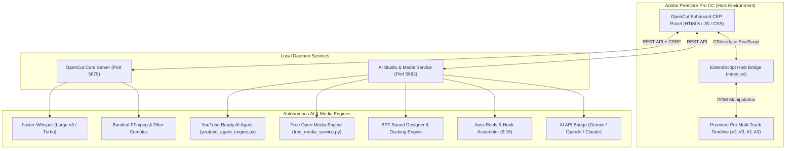

<div align="center">

# 🎬 OpenCut Enhanced
### The Autonomous AI Video Editing Suite & Motion Studio for Adobe Premiere Pro

[](https://opensource.org/licenses/MIT)
[](https://www.adobe.com/products/premiere.html)
[](https://www.python.org/)
[](https://nodejs.org/)
[](https://developer.nvidia.com/cuda-zone)
[](https://github.com/openai/whisper)

**OpenCut Enhanced** is an autonomous, production-grade AI video editing engine and Premiere Pro CEP extension. It transforms raw, unedited footage into high-retention, studio-quality videos and viral 9:16 Shorts/Reels with dead-air trimming, intelligent sound design, multi-LLM moment extraction, beat-synced cuts, free stock media integration, and multilingual kinetic karaoke captions.

[Features Overview](#-complete-features-breakdown) • [YouTube AI Agent](#-autonomous-youtube-ai-editor-agent) • [Free Media Studio](#-free-open-media--sfx-studio) • [System Architecture](#-system-architecture) • [Quick Start](#-quick-start--installation) • [Configuration](#-configuration-configyaml) • [License](#-license--attribution)

---

</div>

## 🌟 What Makes OpenCut Enhanced Unique?

OpenCut Enhanced significantly upgrades the original OpenCut foundation into a complete autonomous production studio:

1. **🤖 Autonomous YouTube AI Editor Agent:** 1-click end-to-end editorial pipeline that analyzes speech, cuts dead-air, applies camera punch-in zooms, generates kinetic motion graphics & subtitles, masters audio, and builds a clean 6-track Premiere Pro timeline.
2. **🎁 Free Open Media & SFX Studio:** Built-in browser for 100% free, CC0, and royalty-free B-roll videos (Wikimedia Commons), 25+ studio-grade SFX, and viral reaction meme GIFs with direct 1-click timeline insertion. Zero GPU required!
3. **🧠 Contextual AI Media Matching with User Controls:** AI automatically analyzes spoken dialogue and inserts matching B-roll and reaction memes at the exact timestamps, while giving the creator granular toggle permissions over videos, SFX, GIFs, and motion cards.
4. **📱 Native 9:16 Auto-Reels & Hooks:** Automatic speaker centering, dynamic pacing, viral hook assemblage, and one-click insertion directly into your active Premiere Pro timeline.
5. **🎧 Content-Aware Sound Design:** Auto-detects cuts and motion to generate isolated SFX stems (*whooshes, risers, impacts, clicks*) with automatic audio ducking.
6. **🌐 Global Multilingual & Bengali Support:** Native transcription and kinetic subtitle rendering in Bengali/Bangla (`Kalpurush` font fallback), English, and 30+ languages.
7. **🛡️ 100% CUDA Crash Shield:** Custom PyTorch-independent GPU activation allowing Faster-Whisper, CTranslate2, and FFmpeg to leverage full NVIDIA hardware acceleration without crashing.
8. **🎨 Sleek, Modern Minimal UI/UX:** Completely redesigned, distraction-free Premiere Pro CEP panel with fixed z-index layering, clean card layouts, and intuitive controls.

---

## 🤖 Autonomous YouTube AI Editor Agent

Triggered with one click on **"YouTube Ready"**, OpenCut activates an autonomous creative editor agent that processes raw footage into a publication-ready multi-track sequence:

```
[Raw Video Footage]
       │
       ▼
[1. Deep Sequence Ingestion]
   • 16kHz audio extraction + Faster-Whisper word-by-word timestamps
   • Sub-millisecond silence & dead-air interval detection
       │
       ▼
[2. AI Editorial Blueprinting (Gemini 2.5 Flash / Multi-LLM)]
   • Analyzes full narrative cadence, energy peaks, and topic transitions
   • Generates structured blueprint: Hook title, punch-in zoom timestamps, motion cards, and SFX cues
   • Resilient fallback: Seamlessly uses heuristic intelligence if offline or API quota is reached
       │
       ▼
[3. Multi-Track Rendering & Audio Mastering]
   • Track V1: Master cuts + 1.18x dynamic punch-in zooms on vocal emphasis
   • Track V2: Glassmorphic motion graphics (Intro Hook Card + Animated "Subscribe & Bell" Lower Third)
   • Track V3: Word-synced kinetic subtitles (.srt / .ass) with vibrant cyan/yellow keyword highlights
   • Track A1: Clean dialogue mastered to YouTube broadcast standard EBU R128 (-16.0 LUFS)
   • Track A2: Content-aware synchronized SFX stem (whooshes on zooms, impacts on hooks, pops on cards)
   • Track A3: Ambient background music bed with dynamic auto-ducking (-18dB under speech)
       │
       ▼
[4. In-Place Premiere Pro Timeline Assembly]
   • Overwrites clips cleanly onto Tracks V1, V2, V3, A1, A2, A3 aligned to 0:00
   • Adds timeline zoom markers and resets playhead to 0:00 for instant creator review!
```

### Granular AI Media Permission Controls:
Creators maintain 100% authority over what the AI agent can auto-insert:
* `[✓] Auto B-Roll Videos` — AI queries free footage matching the spoken context.
* `[✓] Auto Sound SFX` — Aligns whooshes, impacts, and pops with cuts and zooms.
* `[✓] Auto Reaction GIFs` — Inserts viral reaction memes at punchlines.
* `[✓] Auto Motion Cards` — Displays animated title badges and subscribe callouts.

### ⚡ User-Prioritized AI Agent Settings & Skills:
Creators hold absolute authority over the agent's creative direction via the Settings tab:
* **Custom Backend Agent Directive (Highest Priority ⚡):**
  * Pass direct natural language instructions (e.g. *"Emphasize humorous remarks with 1.25x camera snaps"*, *"Use sarcastic tech reviewer hook titles"*, *"Aggressively cut under 25s"*).
  * The AI Agent injects this prompt with top priority over default rules.
* **Modular Agent Skills Library (`E:\autocut\skills`):**
  * **YouTube Retention Master:** Pacing, hook cards, subscribe callouts, punch-in zooms.
  * **Viral TikTok & Reels Specialist:** 9:16 vertical hook detection, dynamic progress bar, reaction memes.
  * **Clean Educational & Coding Guide:** Subtle 1.12x zooms, minimal sound design, boxed high-contrast captions.
  * **Gaming & Stream Climax:** 808 bass drops, snap-in pop zooms, and clutch reaction overlays.
  * **`+ Add Skill` Creator:** Easily create, activate, toggle, or delete custom skill files right from the UI.

---

## 🎁 Free Open Media & SFX Studio

OpenCut Enhanced includes a dedicated **Free Stock Media & SFX Browser** embedded directly inside the Premiere Pro panel. No expensive subscriptions or GPU compute required:

```
┌────────────────────────────────────────────────────────────────────────┐
│  🎁 Free Open Media & SFX Studio (100% Free & CC0 Royalty-Free)       │
├────────────────────────────────────────────────────────────────────────┤
│  [🎬 Video B-Roll]       [🔊 Sound SFX]       [🎭 GIFs & Memes]        │
├────────────────────────────────────────────────────────────────────────┤
│  🔍 Search: [ drone, cyberpunk, whoosh, excited...          ] [Search] │
│  🏷️ Pills:  [All] [Cinematic] [Tech] [Nature] [Urban] [Whoosh] [Impact]│
├────────────────────────────────────────────────────────────────────────┤
│  ⚙️ Timeline Placement Controls (User Customizable):                  │
│  • Target Track:     [ V2 (Overlay / B-Roll) ▼ ]  (V1, V2, V3, A1, A2, A3)│
│  • Placement Time:   [ At Current Playhead   ▼ ]  (Playhead, 0:00, End)│
├────────────────────────────────────────────────────────────────────────┤
│  📦 Results Grid:                                                      │
│  ┌───────────────────────┐         ┌───────────────────────┐          │
│  │ [Thumbnail / Preview] │         │ [Thumbnail / Preview] │          │
│  │ Drone Ocean Waves     │         │ Cyberpunk Matrix Code │          │
│  │ Nature · CC0 Free     │         │ Tech · CC0 Free       │          │
│  │ [▶ Preview] [+ Insert]│         │ [▶ Preview] [+ Insert]│          │
│  └───────────────────────┘         └───────────────────────┘          │
└────────────────────────────────────────────────────────────────────────┘
```

### Media Catalogs:
* **🎬 Video B-Roll:**
  * Direct integration with **Wikimedia Commons Open Video Search** (100% public domain & CC-BY videos, zero API keys required).
  * Curated 4K/HD loops: *Cinematic Drone, Nature Cascades, Cyberpunk Code, City Life, Space*.
* **🔊 Sound SFX (25+ Studio-Grade Audio Assets):**
  * Built-in CC0 sound library: *Whoosh Fast, Whoosh Soft, Impact 808, Sub Drop, Pop Snap, UI Click, Notification Bell, Trailer Braam, Record Scratch*.
  * DSP-synthesized audio normalized with true-peak limiting.
* **🎭 GIFs & Reaction Memes:**
  * Viral creator reaction clips: *Mind Blown, DiCaprio Gatsby Cheers, Popcat, Slow Clap Applause, Confused Math, Picard Facepalm*.
* **⚡ Automatic Transcoding & 1-Click Timeline Placement:**
  * Downloads remote media and losslessly converts `.webm` and animated `.gif` into pristine H.264 `.mp4` using bundled FFmpeg.
  * User selects **Target Track** (V1, V2, V3, A1, A2, A3) and **Placement Position** (Playhead, Sequence Start, Sequence End).

---

## 🚀 Complete Features Breakdown

OpenCut Enhanced is organized into 6 powerful dedicated suites:

### 1. ✂️ Cut & Clean Suite
* **The Silencer (Dead-Air Trimming):**
  * Sub-millisecond silence removal using high-precision audio energy analysis.
  * Preserves natural speech flow with **word padding** (`0.08s`) to prevent clipped syllables, and a **merge threshold** (`0.15s`) to eliminate stutter cuts.
  * Flexible modes: *In-place Timeline Ripple Delete*, *Speed-up Silences (2x–8x)*, or *XML Sequence Export*.
* **Filler Word Removal:**
  * Detects and removes filler utterances (`um`, `uh`, `like`, `you know`, and Bengali fillers: `mane`, `ar`, `hmm`).
  * Boundary review player allowing editors to audition and fine-tune cut points before applying.
* **Smart AutoZoom:**
  * Adds dynamic camera zoom cuts (1.1x–1.3x) based on natural conversational cadence and vocal emphasis.
  * Supports *Smooth Ease* or *Instant Punch-in* styles with automatic track targeting.
* **Auto-Reels & Viral Shorts Agent (Multi-Track & Layout Modes):**
  * Autonomous conversion of long-form or horizontal footage into high-retention 9:16 vertical Reels and Shorts.
  * **Advanced Framing Layouts:**
    * *9:16 Center Face Crop* — Dynamic camera framing with punch-in zooms.
    * *9:16 Blurred Background* — No cropping; centers full wide footage over an animated Gaussian-blurred backdrop.
    * *9:16 Split Screen* — Stacked dual-frame layout (Top face / Bottom action or B-roll).
    * *1:1 Square & Original Ratio* — Perfect for Instagram feeds, LinkedIn, and multi-platform distribution.
  * **Remotion & HyperFrames Motion Overlays (Track V2):**
    * Generates a transparent RGBA `.mov` overlay featuring a dynamic bottom progress bar (`1080*t/duration`) and a glassmorphic intro hook card (`"WATCH UNTIL THE END"`).
  * **Full Multi-Track Premiere Pro Timeline Assembly:**
    * Automatically configures 9:16 vertical sequences in Premiere Pro with separated tracks:
      * **V1:** Master cuts with camera punch-in zooms.
      * **V2:** Motion graphic progress bar, hook cards, and AI contextual B-Roll / Reaction GIFs.
      * **V3:** Kinetic karaoke subtitles (.srt / .ass).
      * **A1:** Master dialogue leveled to EBU R128 (-16 LUFS).
      * **A2:** Synchronized SFX stem (whooshes, impacts, pops).
  * **Granular AI Media Permissions:** Full user toggles for Auto B-Roll, Auto SFX, Reaction GIFs, and Motion Overlays.
  * Evaluates moments with **Viral Scoring (65–95+)** using transcript hooks and vocal energy peaks.
  * One-click `Add to Timeline` instantly builds the multi-track sequence in Premiere Pro.
* **Auto-Hook Intro Generator:**
  * Assembles an electrifying 3–8 second high-retention preview hook at the start of your video with kinetic overlays and transition whooshes.
* **Full AutoCut & Cleanup Chain:**
  * Chains silence removal, filler cleanup, audio leveling, and zoom into a single automated pipeline.

---

### 2. 💬 Captions & Subtitles Suite
* **Kinetic Karaoke Subtitles:**
  * Dynamic, word-by-word karaoke text highlighting (vibrant cyan/yellow active highlight).
  * Styled caption presets: clean minimal, boxed background, neon glow, and drop shadows.
  * Strict mobile UI safe margin compliance (`margin_v: 180`) clear of TikTok, Reels, and Shorts overlay buttons.
* **Multilingual & Bengali (Bangla) Typography:**
  * Full Unicode rendering using `Kalpurush` for Bengali (`\u0980`–`\u09FF`), `Nirmala UI` for Indic scripts, and `Arial` for Latin.
  * Zero character overlapping or broken conjuncts (যুক্তবর্ণ).
* **Multi-Format Export & Interchange:**
  * Exports formatted `ASS`, `SRT`, `VTT`, and Premiere Pro sequence captions.
  * Direct FFmpeg hardcoded burn-in engine for stand-alone delivery.
* **Speaker Diarization & Sync:**
  * Identifies multiple speakers and displays customizable color-coded speaker badges.
  * Interactive transcript editor with live two-way sync with Premiere's timeline playhead.

---

### 3. 🎧 Audio Suite & Autonomous Sound Designer
* **Autonomous Sound Design Engine:**
  * **BPT (Beat & Point) Triggering:** Automatically places sound effects (*whooshes, risers, impacts, clicks, drops*) exactly on visual cuts, text reveals, and camera moves.
  * Generates and mixes an isolated `_sfx_stem.wav` track alongside master video outputs.
* **Dynamic Audio Ducking:**
  * Intelligently reduces background music levels (-18 dB to -24 dB) whenever dialogue is detected and brings it smoothly back up during pauses.
* **EBU R128 Loudness Normalization:**
  * Professional broadcast-grade audio mastering targeting `-16.0 LUFS` (YouTube / Podcast standard) with true-peak limiting.
* **Audio Denoise & Clean:**
  * Eliminates hums, fan noise, and room reverb using DeepFilterNet and spectral gating.
* **AI Stem Separation:**
  * Separates mixed tracks into isolated *Vocals, Drums, Bass, and Other/Music* stems via Demucs / UVR.
* **Music Beat Sync:**
  * Analyzes audio beats and drops timeline sequence markers for rhythm-aligned video cuts.

---

### 4. 🎥 Video Tools Suite
* **Free Stock Media & SFX Browser:**
  * Integrated panel to search, preview, and insert B-roll, SFX, and GIFs into Premiere Pro.
* **AI Auto-Reframe:**
  * Intelligent face tracking that keeps subjects centered during 16:9 to 9:16 portrait, 1:1 square, or 4:5 social crops.
* **AI Face Blur & Privacy Shield:**
  * Automatic face detection and tracking for blurring or anonymizing identities.
* **Scene Detection:**
  * Automatically detects hard camera cuts and creates cut points on raw media.
* **Motion Graphics & Overlays:**
  * Kinetic lower-thirds, data badges, and animated cards with smooth cubic-bezier easing (`cubic-bezier(0.34, 1.56, 0.64, 1)`).
* **Video Stabilization & Speed Ramping:**
  * Reduces camera jitter and creates smooth optical-flow speed transitions.

---

### 5. 📤 Export & Publishing Suite
* **Social Platform Presets:**
  * One-click export profiles for YouTube (4K / 1080p), TikTok (9:16 High-Bitrate), Instagram Reels, and Twitter/X.
* **Smart Thumbnail Generator:**
  * Automatically grabs peak facial expressions and adds bold text badges for clickable thumbnails.
* **AI Social Post Generator:**
  * Multi-LLM drafting of YouTube titles, SEO descriptions, timestamped chapters, and hashtags.

---

### 6. 🧠 Search, AI Agent Settings & Moment Intelligence
* **Custom Backend Directive Prompt (Highest Priority):**
  * Dedicated creative directive box in Settings; overrides or steers how the AI edits footage, designs hooks, and places zooms.
* **Modular Agent Skills Manager (`skills/*.json`):**
  * Toggle pre-built or custom editor personas (Retention Master, Viral Reels, Educational, Gaming) or add new custom skills on the fly.
* **Multi-LLM Integration:**
  * Connects with **Google Gemini, OpenAI, Anthropic Claude, OpenRouter, and Groq**.
  * Analyzes complete transcripts to score hook strength, narrative retention, and comedy beats.
* **Natural Language Command Center:**
  * Execute natural editing requests: *"Cut silences longer than 0.5s and generate an action-packed 30-second Reel"*.

---

## 🏛️ System Architecture



---

## 📦 Quick Start & Installation

### Requirements
* **OS:** Windows 10 or 11 (64-bit)
* **Editor:** Adobe Premiere Pro (2022 to 2026+)
* **Python:** 3.10+ (Python 3.12 or 3.13 recommended)
* **Hardware:** NVIDIA GPU with CUDA drivers recommended (CPU fallback supported)

### 1. Clone the Repository
```bash
git clone https://github.com/RakibAhmed642/OpenCut-Enhanced.git
cd OpenCut-Enhanced
```

### 2. ⚡ One-Click Automatic Setup & Desktop Icon
Run the universal auto-setup script once after cloning:
```bash
python setup_environment.py
```
This automatically:
1. Enables **PlayerDebugMode** in Windows Registry across all Premiere Pro versions (CSXS.9–CSXS.18).
2. Installs and links the **OpenCut CEP panel** directly into `%APPDATA%\Adobe\CEP\extensions`.
3. Creates a **1-Click "OpenCut Enhanced" Desktop Shortcut** with the official logo icon.

### 3. 🚀 Launching OpenCut
Whenever you want to use OpenCut:
* **Option A (Desktop):** Simply double-click the **"OpenCut Enhanced"** icon on your Desktop! It launches both background AI daemons (Port 5679 and Port 5682).
* **Option B (Batch Launcher):** Double-click `Start-OpenCut.bat`.
* **Inside Premiere Pro:** Open your sequence, then go to **Window → Extensions → OpenCut**.

Or start via PowerShell:
```powershell
# OpenCut Core Server (Port 5679)
.\server\OpenCut-Server.exe

# AI Studio & Sound Designer Service (Port 5682)
python server\sound_designer_service.py
```

---

## ⚙️ Configuration (`config.yaml`)

All global parameters can be fine-tuned in [`config.yaml`](config.yaml):

```yaml
# Silence Detection & Trimming
silence:
  noise_threshold_db: -30.0   # Decibel noise floor
  min_duration: 0.5           # Minimum silence gap to cut (seconds)

padding:
  word_padding: 0.08          # Prevents syllable clipping
  merge_threshold: 0.15       # Merges micro-cuts

# Kinetic Captions & Fonts
captions:
  font_name: "Arial"
  bengali_font: "Kalpurush"
  font_size: 26
  primary_color: "&H00FFFFFF"   # White text
  highlight_color: "&H0022D3EE" # Cyan active karaoke highlight
  outline_width: 3.5
  margin_v: 180                 # TikTok/Reels/Shorts UI safe margin

# Sound Design & Loudness
rendering:
  target_lufs: -16.0            # EBU R128 YouTube broadcast standard
  ducking_depth_db: -18.0       # Music attenuation during speech
```

---

## 🤝 Contributing

We welcome contributions, bug reports, and suggestions!
1. Fork the repository.
2. Create your feature branch (`git checkout -b feature/MyFeature`).
3. Commit your changes (`git commit -m 'Add MyFeature'`).
4. Push to your branch (`git push origin feature/MyFeature`).
5. Open a Pull Request.

---

## 📄 License & Attribution

This project is licensed under the **MIT License** - see the [LICENSE](LICENSE) file for details.

### Upstream Attribution:
* Based upon and enhanced from the original open-source **[OpenCut](https://github.com/SysAdminDoc/opencut)** project by **SysAdminDoc**, released under the MIT License.
* Copyright (c) 2025 OpenCut Contributors.
* Copyright (c) 2026 OpenCut Enhanced Contributors.
